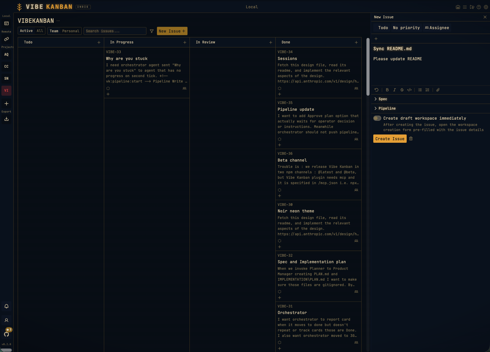
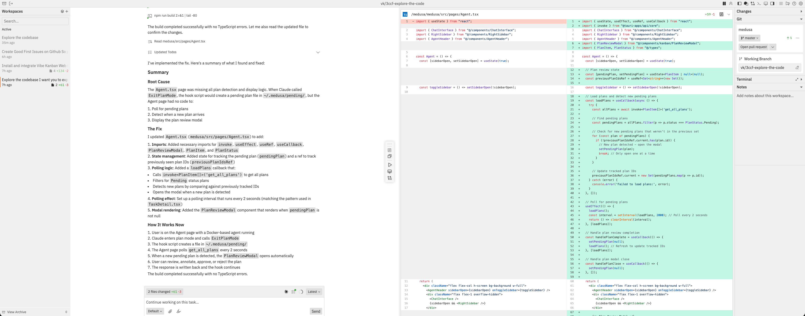

<p align="center">
  <a href="https://dexloom.mintlify.app">
    <picture>
      <source srcset="packages/public/hivedeck-logo-dark.svg" media="(prefers-color-scheme: dark)">
      <source srcset="packages/public/hivedeck-logo.svg" media="(prefers-color-scheme: light)">
      
    </picture>
  </a>
</p>

<p align="center">Get 10X more out of Claude Code, Gemini CLI, Codex, Amp and other coding agents...</p>
<p align="center">
  <a href="https://www.npmjs.com/package/hivedeck"></a>
  <a href="https://github.com/trieuluan/hivedeck/actions/workflows/release-indie.yml"></a>
  <a href="https://deepwiki.com/BloopAI/vibe-kanban"></a>
</p>

<h1 align="center"><strong>HiveDeck</strong></h1>
<p align="center">
  Multi-project control deck for a crew of AI coding agents. One dev, your machine, your
  agents — drive a crew of coding agents from the terminal or your phone.
</p>
<p align="center">
  Built for a <strong>single-developer process</strong>: no team, no cloud, no
  auth. Adds a <a href="#terminal-ui-tui">TUI cockpit</a> and
  <a href="#telegram-integration">Telegram channel orchestration</a> on top of
  upstream <a href="https://github.com/BloopAI/vibe-kanban">vibe-kanban</a>.
</p>



# Welcome to HiveDeck

## About this fork

HiveDeck is forked from [dendroman/vibe-kanban-indie](https://github.com/dendroman/vibe-kanban-indie), itself a fork of [dexloom/vibe-kanban-indie](https://github.com/dexloom/vibe-kanban-indie) and upstream [BloopAI/vibe-kanban](https://github.com/BloopAI/vibe-kanban) (all Apache-2.0).

Roadmap: multi-project management, 9router integration with per-role model combos, an IDE-like code/diff viewer, and control from mobile/Telegram.

Inherited from the previous fork: bumped to **codex 0.152.1**:

- `crates/executors` pins `npx -y @openai/codex@0.152.1` and compiles against the `rust-v0.152.1` protocol crates (`codex-app-server-protocol`, `codex-protocol`).
- Migrates `crates/executors/src/executors/codex/*.rs` to the 0.152.1 app-server protocol (`permissionProfile` removed from thread/fork params, `AskForApproval::OnRequest`, `service_tier` as `Option<String>`, `EventMsg` renames, `ThreadItem::WebSearch` tuple variant, ...).
- `sqlx` 0.8.6 → 0.9.0 (unifies `libsqlite3-sys` 0.37 with `codex-state`); `tokio-tungstenite` 0.28 with the upstream `[patch.crates-io]` openai-oss-forks.
- `build-env.sh` + `build-frontend.sh`: headless-VM build recipe (locally extracted `libsqlite3-dev` + libclang shim, pnpm via corepack).

Why: VK 0.2.27 hard-codes the codex CLI it spawns. If the pin is older than the model configured in `~/.codex/config.toml` (e.g. 0.124.0 vs `gpt-5.6-sol`), every VK-spawned run fails with a model-rejection error while your own `codex exec` works fine.

---


## Overview

In a world where software engineers spend most of their time planning and reviewing coding agents, the most impactful way to ship more is to get faster at planning and review.

`hivedeck` is built for this — for a single developer, running entirely on your own machine. Use kanban issues to plan work, then create workspaces where coding agents can execute.

- **Plan with kanban issues** — create, prioritise, and assign issues on a kanban board
- **Run coding agents in workspaces** — each workspace gives an agent a branch, a terminal, and a dev server
- **Review diffs and leave inline comments** — send feedback directly to the agent without leaving the UI
- **Preview your app** — built-in browser with devtools, inspect mode, and device emulation
- **Switch between 10+ coding agents** — Claude Code, Codex, Gemini CLI, GitHub Copilot, Amp, Cursor, OpenCode, Droid, CCR, and Qwen Code
- **Create pull requests and merge** — open PRs with AI-generated descriptions, review on GitHub, and merge



One command. Describe the work, review the diff, ship it.

```bash
npx hivedeck
```


## Installation

Make sure you have authenticated with your favourite coding agent. A full list of supported coding agents can be found in the [docs](https://dexloom.mintlify.app/supported-coding-agents). Then in your terminal run:

```bash
npx hivedeck
```

## Terminal UI (TUI)

`hivedeck-tui` is a terminal cockpit for the backend — list workspaces and sessions, watch live agent transcripts, manage a kanban board for local projects, and approve/deny/answer the things agents block on, all without leaving the terminal. It's also the always-available manual override for the [Telegram automation](#telegram-integration) below.

Run it against a running backend (it discovers the backend via its port file, or set `VIBE_BACKEND_URL`):

```bash
cargo run -p tui
```

Keys (press `?` in-app for the full list):

| Context | Keys |
|---|---|
| Global | `a` approvals inbox · `?` help · `q` quit |
| List | `↑↓`/`jk` move · `⇥` switch pane · `⏎` open · `n` new task · `b` board · `r` refresh |
| Detail | `⇥`/`←→` move focus between panes (processes · git · transcript) · `↑↓`/`jk` navigate the focused pane · `n`/`p` process · `f` follow · `i` message agent · `s` stop · `esc` back |
| Git pane (in detail) | focus it with `⇥`, then `↑↓` select repo · `m` merge · `R` rebase · `P` create PR · `u` push — shows branch→target, ↑ahead/↓behind, ±diff, PR state per repo |
| Approvals inbox | `↑↓` move · `y` approve · `d` deny · `⏎` answer · `esc` back |
| Board | `←→` column · `↑↓` card · `[ ]` move card · `n` new · `e` edit · `d` delete · `w` workspace · `p` project · `⏎` detail |

## Telegram Integration

`hivedeck-telegram-bridge` is a **send-only** daemon that streams coding-agent escalations to a Telegram supergroup, so a blocked agent (waiting on a tool-permission prompt or a clarifying question) can be unblocked remotely — by a human replying in Telegram, or by a PM agent acting through the MCP approval tools. The bridge never reads Telegram and never polls the bot token, so it coexists with the sombrax-telegram listener without a 409 conflict.

It is configured by `~/.hivedeck/telegram.toml` (see `automation/telegram.toml.example`):

```toml
# ~/.hivedeck/telegram.toml
enabled = true
bot_token = "123456:ABC..."        # optional; falls back to $TELEGRAM_BOT_TOKEN
                                   # or ~/.claude/channels/telegram/.env
chat_id = "-1001234567890"         # your supergroup (must have Topics enabled)
general_thread_id = "1"            # optional General topic
per_worktree_topics = true         # spawn a forum topic per Claude Code worktree
# topic_executors = ["CLAUDE_CODE"]  # which executors get a topic
# topic_name_template = "vk: {name}" # {name}/{branch} substituted
```

```bash
cargo run -p telegram-bridge
```

When `enabled = false` (or no config is present), the daemon exits cleanly. With `per_worktree_topics = true`, the bridge watches the backend's `/api/events` stream and creates a dedicated forum topic for each opted-in worktree, routing that worktree's escalations into it; the `workspace_id → message_thread_id` map is persisted in `~/.hivedeck/telegram-topics.json` so restarts reuse existing topics.

The app surfaces a read-only **Settings → Telegram** panel (status + a "Send test message" button); it reads `telegram.toml` and the bridge's heartbeat file but does not edit the config — the TOML is hand-edited.

For the full architecture (TUI, bridge, MCP approval tools, and the PM agent), see [`automation/README.md`](automation/README.md).

## Claude Code Plugins (SombraX)

The automation layer is driven from Claude Code by three plugins published in the **`sombrax_plugins`** marketplace: **hivedeck** (orchestration skills, the agent crew, and the bundled `hivedeck` MCP server), **sombrax-telegram** (the inbound Telegram channel listener that pairs with the send-only bridge above), and **sombrax-codex** (Codex CLI helpers for independent plan and code review).

Add the marketplace once, then install the plugins you want — from inside Claude Code:

```text
# Add the marketplace (once)
/plugin marketplace add dexloom/sombrax_plugins

# Install the plugins
/plugin install hivedeck@sombrax-plugins
/plugin install sombrax-telegram@sombrax-plugins
/plugin install sombrax-codex@sombrax-plugins
```

The plugins are optional — Indie's web UI, board, and workspaces work without them. Install them when you want to drive the board and the agent crew from Claude Code. See [Claude Code plugins & skills](https://dexloom.mintlify.app/integrations/claude-code-plugins) for the full breakdown.

## Documentation

Head to the [documentation site](https://dexloom.mintlify.app) for the latest guides, including [What's different in Indie](https://dexloom.mintlify.app/indie/whats-different) and the [Solo Cockpit](https://dexloom.mintlify.app/cockpit/index).

## Self-Hosting

Indie runs entirely on your own machine — no cloud, no account. See the [self-hosting guide](https://dexloom.mintlify.app/self-hosting/local-development) to run it locally or [behind Docker](https://dexloom.mintlify.app/self-hosting/deploy-docker).

## Support

For feature requests and bugs, please open an issue on [`trieuluan/hivedeck`](https://github.com/trieuluan/hivedeck/issues).

## Contributing

`hivedeck` is an independent, single-developer fork. Please raise ideas and changes as issues on [`trieuluan/hivedeck`](https://github.com/trieuluan/hivedeck/issues) before opening a PR, so we can discuss implementation details and alignment with the roadmap.

## Development

### Prerequisites

- [Rust](https://rustup.rs/) (latest stable)
- [Node.js](https://nodejs.org/) (>=20)
- [pnpm](https://pnpm.io/) (>=8)

Additional development tools:
```bash
cargo install cargo-watch
cargo install sqlx-cli
```

Install dependencies:
```bash
pnpm i
```

### Running the dev server

```bash
pnpm run dev
```

This will start the backend and web app. A blank DB will be copied from the `dev_assets_seed` folder.

### Building the web app

To build just the web app:

```bash
cd packages/local-web
pnpm run build
```

### Build from source (macOS)

1. Run `./local-build.sh`
2. Test with `cd npx-cli && node bin/cli.js`

### Environment Variables

The following environment variables can be configured at build time or runtime:

| Variable | Type | Default | Description |
|----------|------|---------|-------------|
| `PORT` | Runtime | Auto-assign | **Production**: Server port. **Dev**: Frontend port (backend uses PORT+1) |
| `BACKEND_PORT` | Runtime | `0` (auto-assign) | Backend server port (dev mode only, overrides PORT+1) |
| `FRONTEND_PORT` | Runtime | `3001` | Frontend dev server port (dev mode only, overrides PORT) |
| `HOST` | Runtime | `127.0.0.1` | Backend server host |
| `MCP_HOST` | Runtime | Value of `HOST` | MCP server connection host (use `127.0.0.1` when `HOST=0.0.0.0` on Windows) |
| `MCP_PORT` | Runtime | Value of `BACKEND_PORT` | MCP server connection port |
| `DISABLE_WORKTREE_CLEANUP` | Runtime | Not set | Disable all git worktree cleanup including orphan and expired workspace cleanup (for debugging) |
| `VK_ALLOWED_ORIGINS` | Runtime | Not set | Comma-separated list of origins that are allowed to make backend API requests (e.g., `https://my-hivedeck-frontend.com`) |

**Build-time variables** must be set when running `pnpm run build`. **Runtime variables** are read when the application starts.

#### Self-Hosting with a Reverse Proxy or Custom Domain

When running HiveDeck behind a reverse proxy (e.g., nginx, Caddy, Traefik) or on a custom domain, you must set the `VK_ALLOWED_ORIGINS` environment variable. Without this, the browser's Origin header won't match the backend's expected host, and API requests will be rejected with a 403 Forbidden error.

Set it to the full origin URL(s) where your frontend is accessible:

```bash
# Single origin
VK_ALLOWED_ORIGINS=https://vk.example.com

# Multiple origins (comma-separated)
VK_ALLOWED_ORIGINS=https://vk.example.com,https://vk-staging.example.com
```

### Remote Deployment

When running HiveDeck on a remote server (e.g., via systemctl, Docker, or cloud hosting), you can configure your editor to open projects via SSH:

1. **Access via tunnel**: Use Cloudflare Tunnel, ngrok, or similar to expose the web UI
2. **Configure remote SSH** in Settings → Editor Integration:
   - Set **Remote SSH Host** to your server hostname or IP
   - Set **Remote SSH User** to your SSH username (optional)
3. **Prerequisites**:
   - SSH access from your local machine to the remote server
   - SSH keys configured (passwordless authentication)
   - VSCode Remote-SSH extension

When configured, the "Open in VSCode" buttons will generate URLs like `vscode://vscode-remote/ssh-remote+user@host/path` that open your local editor and connect to the remote server.

See the [documentation](https://dexloom.mintlify.app/settings/general) for detailed setup instructions.
